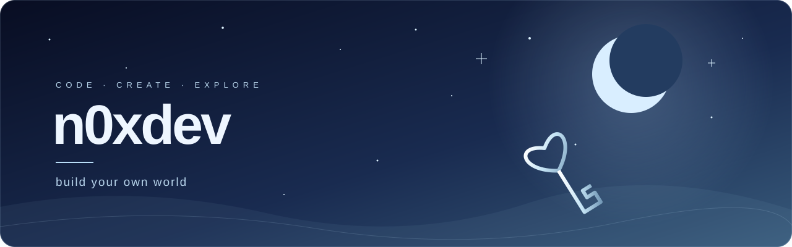

  

  <b>Interfaces, jogos e ideias que viram projetos.</b> 
  Interfaces, games, and ideas brought to life.

  <a href="https://github.com/kazumhub-pixel/orbit-launcher">Orbit Launcher</a>
  &nbsp; · &nbsp;
  <a href="https://github.com/kazumhub-pixel/orbit-launcher/releases/latest">Download</a>
  &nbsp; · &nbsp;
  <a href="https://github.com/kazumhub-pixel?tab=repositories">Projetos / Projects</a>

---

### Sobre / About

Sou **n0xdev**. Estou construindo o **Orbit Launcher**, um launcher de Minecraft com uma interface própria, temas e personalização.

I'm n0xdev. I'm building Orbit Launcher, a Minecraft launcher with a custom interface, themes, and personalization.

### Em destaque / Featured

**[Orbit Launcher](https://github.com/kazumhub-pixel/orbit-launcher)**

Um lugar para organizar instâncias, mods e o seu próximo mundo.

A place to organize instances, mods, and your next world.

- Interface com fundos personalizados, imagens e vídeos.
- Perfis, skins e gerenciamento de instâncias.
- Seis idiomas e instalador para Windows.

**[Baixar para Windows / Download for Windows →](https://github.com/kazumhub-pixel/orbit-launcher/releases/latest)**

### No código / In the code

`C++` &nbsp; `Qt` &nbsp; `Lua` &nbsp; `Git`

n0xdev · build your own world

